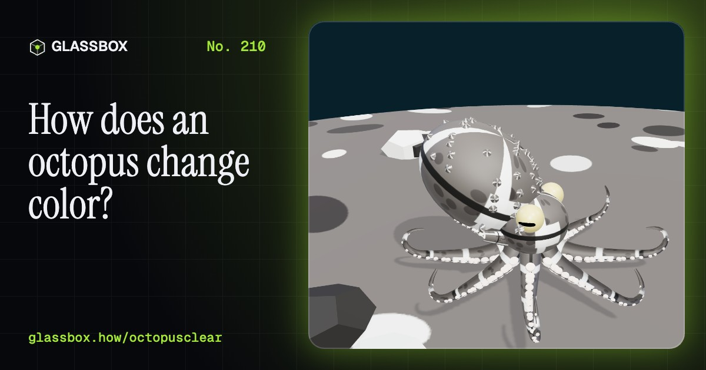
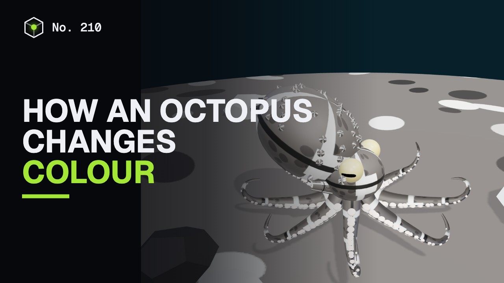
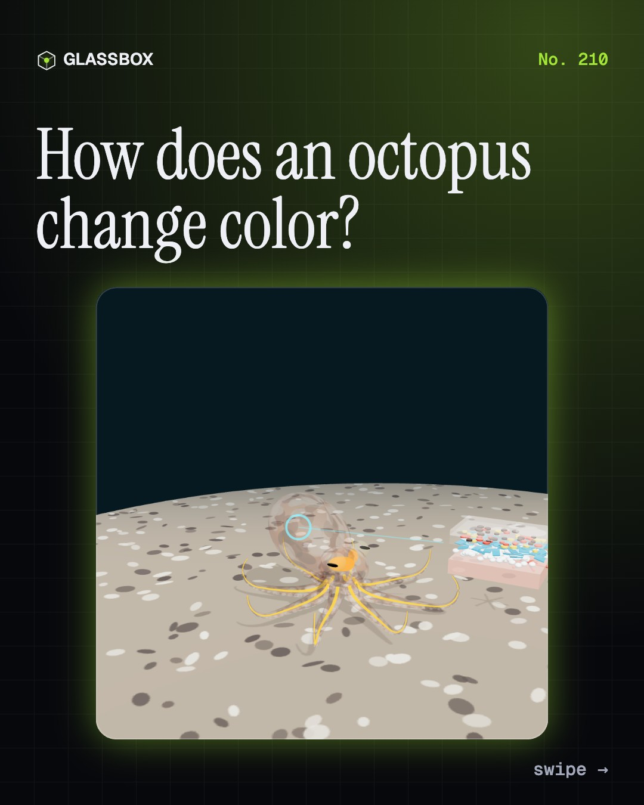
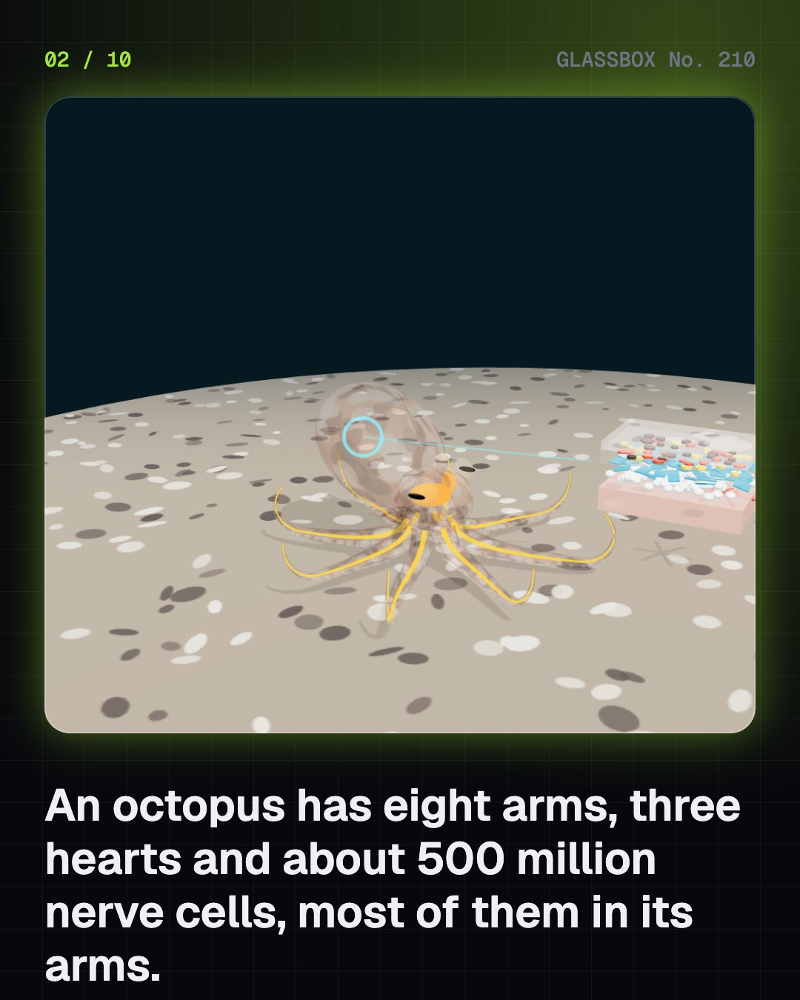
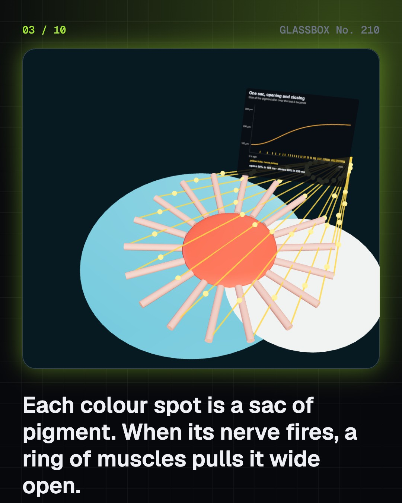
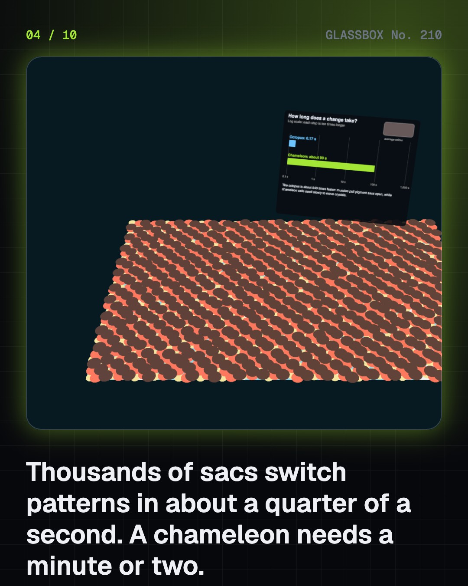

<!-- glassbox:start -->
<!-- Generated from glassbox.json by the Glassbox hub (npm run readme -- octopusclear). Edit glassbox.json, not this block. -->
<p align="center"><a href="https://glassbox.how/e/octopusclear/"></a></p>

<h1 align="center">OctopusClear</h1>

<p align="center"><b>How does an octopus change color?</b><br>An octopus can repaint its whole body in a fraction of a second. Its skin is a screen of thousands of tiny pigment bags, each pulled open by its own ring of muscles on orders from the brain. Fire the nerves and watch the pixels open.</p>

<p align="center"><a href="https://glassbox.how/octopusclear/"><b>▶ Play with it</b></a> &nbsp;·&nbsp; <a href="https://glassbox.how/e/octopusclear/">Read the 60-second explainer</a> &nbsp;·&nbsp; <a href="https://glassbox.how/octopusclear/glassbox/reel.mp4">Watch the 40-second video</a></p>

<p align="center">
  <a href="https://glassbox.how/e/octopusclear/"></a>
  <a href="https://glassbox.how/e/octopusclear/"></a>
  <a href="LICENSE"></a>
  <a href="LICENSE-CONTENT.md"></a>
  <a href="#privacy"></a>
</p>

## In 60 seconds

1. **Eight arms and a living screen.** A common octopus has a soft mantle, eight sucker-lined arms, a siphon, slit-pupil eyes and about 500 million nerve cells, two-thirds of them in its arms. Its skin stacks pigment sacs over mirror plates, white cells and muscles that raise bumps.
2. **Pixels with muscles.** Each chromatophore is an elastic bag of yellow, red or brown pigment ringed by radial muscles wired to the brain. When the nerves fire, the muscles pull it open in a tenth to a third of a second; when they stop, it springs shut. A chameleon’s crystal cells take a minute or two.
3. **Three disguises, and some acts.** Most camouflage is uniform, mottle or disruptive, chosen from the size, contrast and edges of things nearby. Octopuses also masquerade as weed or rock, and the mimic octopus of Indonesia impersonates lionfish, flatfish and sea snakes.
4. **Colour-blind, yet colour-matching.** Octopus eyes have one kind of light sensor, so they should be colour-blind. Ideas include light-sensing skin, colour pulled from blur by the odd pupil, and matching brightness and pattern alone. Nobody knows yet.
5. **Cousins, catches and care.** Cuttlefish and squid use the same muscle-driven cells. India lands about two lakh tonnes of cephalopods a year, mostly squid and cuttlefish. The blue-ringed octopus, found in Indian waters, must never be touched, and UK law now recognises cephalopods as sentient.
6. **How we found out.** Aristotle saw octopuses match stones; Sangiovanni named the chromatophores in 1819; J. Z. Young mapped the octopus brain; Hanlon and Messenger decoded the patterns; and engineers now build robot skins that copy them.

## Words worth knowing

| Term | Meaning |
|---|---|
| **Chromatophore** | In cephalopods, an organ made of an elastic pigment sac, a ring of radial muscles and their nerves. |
| **Radial muscle** | One of the spoke-like muscles that pull a chromatophore sac open when its nerve fires. |
| **Iridophore** | A cell with stacks of thin plates that reflect one colour by interference. |
| **Leucophore** | A white cell that scatters all colours of light equally. |
| **Papilla** | A skin bump that muscles raise or flatten to change texture. |
| **Disruptive pattern** | Bold patches and lines that break up an animal’s outline. |
| **Masquerade** | Looking like an object, such as a rock or seaweed, instead of the background. |
| **Photoreceptor** | A light-sensing cell. Octopus eyes have only one type. |
| **Sentience** | The capacity to have feelings such as pain and pleasure. |

## A short history

**From Aristotle’s stone-coloured octopus to robot skins: 2,400 years of working out how a body becomes a screen.**

- **350 BCE** · An octopus that matches the stones (Aristotle, Lesbos and Athens)
- **1819** · The colour carriers get a name (Giosuè Sangiovanni, Naples)
- **1968** · Inside a chromatophore organ (Richard Cloney and Ernst Florey, Seattle)
- **1971** · A map of the octopus brain (J. Z. Young, London)
- **2001** · An octopus that impersonates (Mark Norman, Julian Finn and Tom Tregenza, Sulawesi and Bali)
- **2007** · Three ways to hide (Roger Hanlon, Woods Hole)
- **2012** · A blue-ringed octopus in Chennai (Indian fisheries scientists, Kasimedu fishing harbour, Chennai)
- **2014** · A sheet that matches what it sees (Cunjiang Yu, John Rogers, Roger Hanlon and team, Urbana-Champaign and Houston)

The full story, with 28 moments, charts, people and 32 sources: [glassbox.how/e/octopusclear/history](https://glassbox.how/e/octopusclear/history/). The data lives in [`history.json`](history.json).

## Video and slides

Made with the Glassbox studio from this box's storyboard (`window.glassbox.director`). Free to reuse under CC BY 4.0.

<a href="https://glassbox.how/octopusclear/glassbox/video.mp4"></a>

<p><a href="glassbox/slide-1.jpg"></a> <a href="glassbox/slide-2.jpg"></a> <a href="glassbox/slide-3.jpg"></a> <a href="glassbox/slide-4.jpg"></a></p>

| File | What | Size |
|---|---|---|
| [`glassbox/reel.mp4`](https://glassbox.how/octopusclear/glassbox/reel.mp4) | Reel / Short, with captions and soundtrack | 1080×1920 |
| [`glassbox/video.mp4`](https://glassbox.how/octopusclear/glassbox/video.mp4) | YouTube video, with captions and soundtrack | 1920×1080 |
| `glassbox/slide-1…10.jpg` | Instagram carousel | 1080×1350 |
| `glassbox/thumb.jpg` | YouTube thumbnail | 1280×720 |
| `glassbox/cover.jpg` | Share card and repo social preview | 1200×630 |
| [`glassbox/history-reel.mp4`](https://glassbox.how/octopusclear/glassbox/history-reel.mp4) | “History in 10 moments” Reel / Short | 1080×1920 |
| `glassbox/history-slide-*.jpg` | History carousel | 1080×1350 |
| `glassbox/post.json` | Post copy and schedule used by the publish kit | |

## Privacy

This box has no accounts and no ads, and it ships its own fonts and libraries. When you run it yourself it sends nothing anywhere. On glassbox.how, the site's `/bar.js` also loads Glassbox's analytics: **Google Analytics** to count visits (it asks first in the EU, UK and Switzerland, and stays off when your browser sends Global Privacy Control or Do Not Track) and **ClickTrust** to detect bots.

It remembers a few things **in your own browser only**, and never sends them anywhere:

| Browser storage key | What it holds |
|---|---|
| `octopusclear.v1` | Which chapters you have opened, your best quiz scores, and sound on or off. |

Exactly what each one sees is at [glassbox.how/privacy](https://glassbox.how/privacy/).

## Licences

- **Code:** [MIT](LICENSE). Use it, change it, ship it.
- **Explanations, text, images and videos** (`glassbox.json`, `glassbox/`): [CC BY 4.0](LICENSE-CONTENT.md). Credit “Glassbox, glassbox.how/e/octopusclear”.
- **Third-party parts** keep their own licences: [three.js](https://threejs.org) (MIT), [Geist, Instrument Serif](https://openfontlicense.org) (SIL OFL 1.1).
- The Glassbox name and logo aren't covered by either licence. See the [terms](https://glassbox.how/terms/).

Found a mistake? [Open an issue](https://github.com/bdeeps/octopusclear/issues). Corrections happen in public.
<!-- glassbox:end -->

## Run it

It's plain HTML, CSS and JavaScript. No build step and no dependencies. Run locally, it contacts no other website.

```bash
python3 -m http.server 8000
```

Three.js and the fonts ship in `vendor/` and `fonts/`, so it also works offline.

Then open http://localhost:8000.

## How it's built

| File | What |
|---|---|
| `index.html`, `css/app.css` | The page and its styles |
| `js/app.js`, `js/stage.js`, `js/ui.js`, `js/kit.js` | The shared Glassbox 3D engine: chapters, 3D stage, controls, quiz, video director |
| `js/chapters/*.js` | One file per chapter: the 3D model, controls, text, key terms, quiz and video scenes |
| `js/octo.js` | OctopusClear's shared parts: the chromatophore muscle model, the skin-colour model (pigment sacs over mirror plates and white cells, CIE colour from ChameleonClear), the procedural octopus, the cut-open skin, body-pattern painting and chart boards |
| `glassbox.json` | Title, question, explainer beats, key terms, browser storage and credits shown on glassbox.how |
| `reel` in each chapter | The storyboard the Glassbox studio records into short videos |
| `glassbox/` | The published video, slides, thumbnail and post copy |
| `fonts/`, `vendor/three/` | Self-hosted Geist and Instrument Serif (SIL OFL 1.1) and three.js (MIT) |
